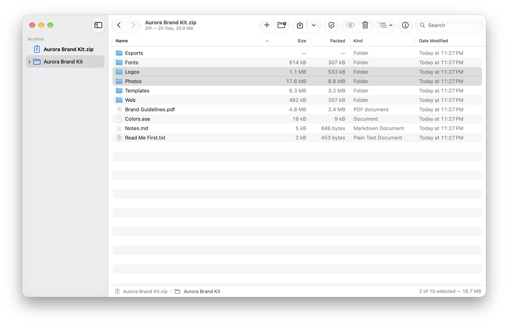
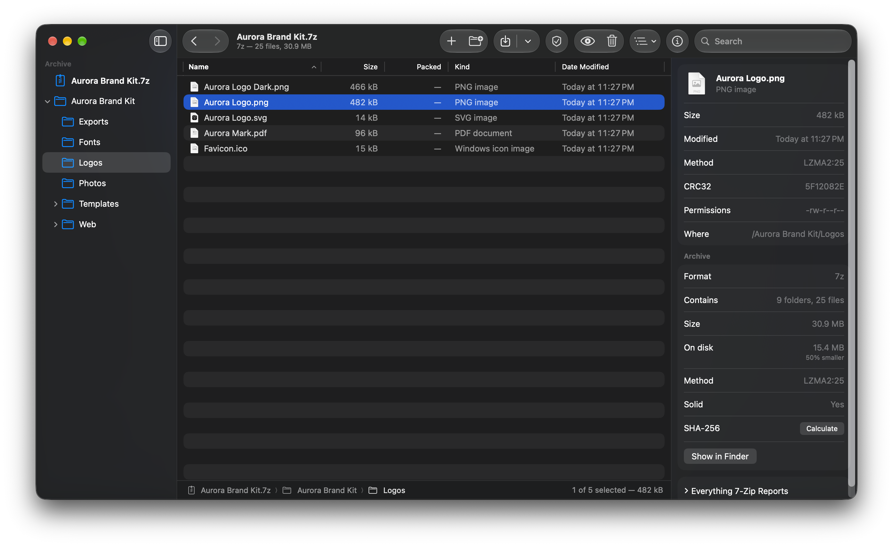
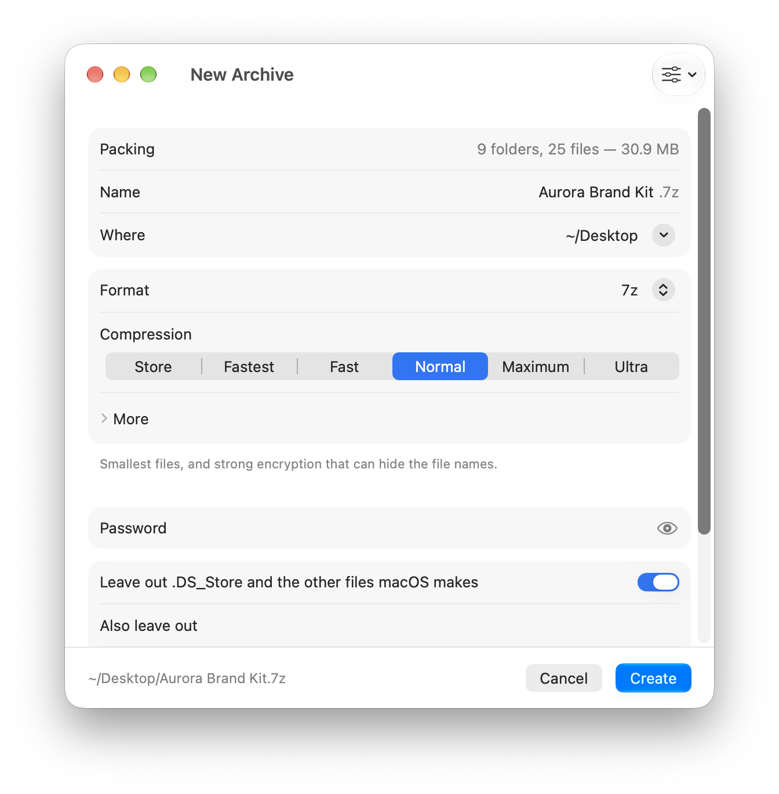
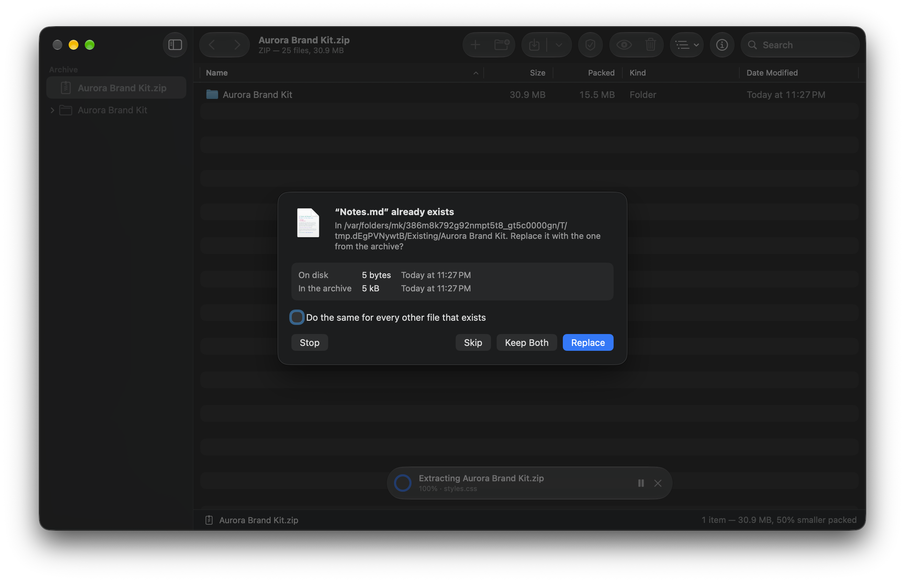

<div align="center">


# OpenZip

### The archive manager the Mac was missing.

Open an archive like a folder. Look inside, pull a file out, drop a file in, rename, delete,<br>
without extracting anything first. If you have missed WinRAR since you moved to a Mac, this is it.<br>
**Native Swift on Liquid Glass. ZIP, 7z, RAR, TAR and fifty more. No account, no analytics. Free and open source.**

[](https://github.com/burakgon/openzip-mac/releases/latest)
[](#install)
[](#install)
[](#how-it-works)
[](https://github.com/burakgon/openzip-mac/actions/workflows/ci.yml)
[](LICENSE)

[**Download for macOS**](https://github.com/burakgon/openzip-mac/releases/latest/download/OpenZip.dmg) · [Features](#features) · [Formats](#formats) · [Install](#install) · [Keyboard](#keyboard) · [Safety](#safety) · [FAQ](#faq) · [Build it yourself](#build-it-yourself)

<br>

<picture>
  <source media="(prefers-color-scheme: dark)" srcset="docs/images/hero-dark.png">
  
</picture>

</div>

<br>

Double-click an archive and it opens in a window: folders in a sidebar, files in a list you can
sort and search, <kbd>Space</kbd> for Quick Look. Drag a file out to the Finder and only that file
is extracted. Drop a file in and it is added. Nothing is unpacked to make any of that happen.

## Why

macOS can extract a whole archive and make a ZIP of a folder, and that is where it stops. It cannot
show you what is in an archive, take one file out of a 20 GB backup, add a forgotten file to a ZIP,
or put a password on anything.

The apps that can cost money, or are command lines. RAR for the Mac has never had a window at all.

OpenZip is the whole job in one native app that costs nothing: a browser for archives that changes
them in place, a dialog to create them with every option that matters, and the Finder commands
people know from Windows. It is built for macOS 26 and later, on Liquid Glass, and it is careful
with what it extracts onto your disk.

|               |                                                                                       |
| ------------- | ------------------------------------------------------------------------------------- |
| Built with    | Swift 6, SwiftUI and AppKit. No Electron, no web views                                 |
| Engine        | [7-Zip](https://7-zip.org) 26, compiled from its source and run in a process of its own |
| Opens         | [more than fifty formats](#formats), with passwords, split volumes, hidden file names  |
| Creates       | ZIP, 7z, TAR, TAR.GZ, TAR.BZ2, TAR.XZ, WIM, and RAR with RARLAB's RAR                    |
| Memory        | about 80 MB with an archive open. Compression runs in the helper and gives its memory back |
| CPU at rest   | 0%                                                                                     |
| Download      | 7 MB                                                                                   |
| Price         | free, [MIT license](LICENSE)                                                           |

## Features

### Archives open like folders

Folders in the sidebar, files in a list with their size, packed size, kind and date, and more
columns (ratio, CRC32, method, permissions) a right-click on the header away. Folders show what
everything in them adds up to. Type to jump to a name, search by name with or without wildcards
(`*.psd`), or flatten a folder into one list of every file below it.

<kbd>Space</kbd> shows a file in Quick Look. A double click opens it in its app, and if you save
it there, OpenZip offers to put the changed file back into the archive. An archive inside an
archive opens in a window of its own.

<picture>
  <source media="(prefers-color-scheme: light)" srcset="docs/images/info-dark.png">
  
</picture>

### Change an archive without extracting it

- **Add** by dropping files into the window, onto a folder in it, or with <kbd>⌥</kbd><kbd>⌘</kbd><kbd>A</kbd>.
- **Delete**, **rename** in place with <kbd>Return</kbd>, **move** by dragging onto a folder, make a **new folder**.
- **Drag out** to the Finder or any app. Only what you drag is extracted.
- **Update modes**, as in WinRAR: add and replace, add and update, freshen, synchronize.
- Edit the **comment** of a ZIP or RAR archive.

The archive is rewritten with what stays copied over as it is, compressed. A 4 GB ZIP that loses
one file does not get unpacked and packed again. This works for ZIP, 7z, TAR and WIM, for TAR.GZ,
TAR.BZ2 and TAR.XZ (which have to be compressed again, there is no way around it), and for RAR
with [RARLAB's RAR](#what-about-rar).

### Create archives with every option that matters



- **Formats**: ZIP, 7z, TAR, TAR.GZ, TAR.BZ2, TAR.XZ, GZ, BZ2, XZ, WIM, RAR.
- **Six levels** from Store to Ultra, and behind *More*: method (LZMA2, PPMd, BZip2, Deflate64…),
  dictionary size, solid archives, the number of cores.
- **AES-256 passwords**, and for 7z and RAR **hidden file names**: without the password the
  archive shows nothing at all.
- **Split into volumes**: for email, FAT32, DVDs, or any size you type.
- **Leave out what the Finder litters**: no `.DS_Store`, no `__MACOSX`, no `._` files in what you
  send to Windows. Plus your own patterns: `node_modules`, `*.tmp`.
- **One archive per item**, **test when done**, **move the originals to the Trash** once the
  archive has passed its test.
- **Profiles** keep a set of choices under a name. Five come built in.
- **Convert** any archive OpenZip opens into any format it writes.

<br clear="right">

### Extract carefully

*Extract Here* does what the Finder does, and never makes a mess: an archive with one item at its
top gives you that item, an archive with many gives you a folder named after it.

When a file exists already, OpenZip asks, once or for each file, and shows both versions:



Extraction goes into a hidden work folder first and is moved into place when it is complete. A
wrong password, a damaged archive or a click on Stop leaves nothing half-written behind.

### At home in the Finder

Right-click any files in the Finder:

| On an archive                        | On anything else              |
| ------------------------------------ | ----------------------------- |
| Extract Here                         | Compress to “Name.zip”        |
| Extract to “Name”                    | Compress to “Name.7z”         |
| Extract to…                          | Compress… (with all options)  |
| Open in OpenZip · Test               |                               |

Drop files on the Dock icon to pack them, or archives to open them. Operations started from the
Finder run in the background with a progress bar on the Dock icon, and OpenZip quits by itself
when they are done.

### <a name="what-about-rar"></a>RAR

OpenZip **opens and extracts RAR** by itself: RAR 5 and older, with passwords, encrypted names
and volumes.

**Creating** RAR archives is something only RARLAB's own program is allowed to do: the format is
proprietary. OpenZip uses that program if it is on your Mac, and Settings → RAR can download it
from rarlab.com for you (it is shareware, free to try for 40 days). With it you get everything
RAR is known for:

- solid archives and RAR's own compression,
- **recovery records**, with which a damaged archive repairs itself,
- **repair**, **lock against changes**, comments, volumes, self-extracting archives.

## Formats

| Open, extract, test | |
| --- | --- |
| Archives | ZIP, ZIPX, 7z, RAR, TAR, CAB, ARJ, LZH, CPIO, AR, XAR, WIM |
| Compression | GZ, BZ2, XZ, Zstandard, LZMA, Z, and TAR in any of them |
| Disk images | ISO, UDF, DMG, IMG, VHD, VHDX, VMDK, VDI, QCOW2 |
| File systems | APFS, HFS+, NTFS, FAT, ext2/3/4, SquashFS, CramFS |
| Packages | PKG, RPM, DEB, JAR, APK, IPA, XPI, MSI, NSIS installers, CHM |
| Also | split archives (.001, .part1.rar, .z01), self-extracting .exe |

| Create and change | |
| --- | --- |
| ZIP | Deflate, Deflate64, BZip2, LZMA, PPMd · AES-256 or ZipCrypto · volumes · comment |
| 7z | LZMA2, LZMA, PPMd, BZip2 · solid · AES-256 with hidden names · volumes |
| TAR, TAR.GZ, TAR.BZ2, TAR.XZ | with permissions and symbolic links |
| GZ, BZ2, XZ | for a single file |
| WIM | uncompressed |
| RAR | with RARLAB's RAR: solid, recovery record, lock, volumes, comment |

## Install

1. **[Download OpenZip.dmg](https://github.com/burakgon/openzip-mac/releases/latest/download/OpenZip.dmg)**,
   open it and drag OpenZip to Applications.
2. Open it. To get the commands in the Finder's menu, turn the extension on:
   *Settings → Finder → Turn On in System Settings…*
3. To have archives open in OpenZip with a double click, choose which under *Settings → Finder*.

Requires macOS 26 or later, on Apple silicon or Intel. The app is signed with a Developer ID and
notarized by Apple, and it updates itself.

## Keyboard

| Key | What it does |
| --- | --- |
| <kbd>⌘</kbd><kbd>N</kbd> · <kbd>⌘</kbd><kbd>O</kbd> | New archive · open an archive |
| <kbd>⌘</kbd><kbd>E</kbd> · <kbd>⇧</kbd><kbd>⌘</kbd><kbd>E</kbd> | Extract… · Extract Here |
| <kbd>⌥</kbd><kbd>⌘</kbd><kbd>A</kbd> · <kbd>⇧</kbd><kbd>⌘</kbd><kbd>N</kbd> | Add files · new folder |
| <kbd>Space</kbd> | Quick Look |
| <kbd>Return</kbd> · <kbd>⌘</kbd><kbd>⌫</kbd> | Rename · delete |
| <kbd>⌘</kbd><kbd>↓</kbd> · <kbd>⌘</kbd><kbd>↑</kbd> | Open the selection · go to the enclosing folder |
| <kbd>⌘</kbd><kbd>[</kbd> · <kbd>⌘</kbd><kbd>]</kbd> | Back · forward |
| <kbd>⌘</kbd><kbd>F</kbd> | Search |
| <kbd>⌘</kbd><kbd>1</kbd> · <kbd>⌘</kbd><kbd>2</kbd> | Folders · all files in one list |
| <kbd>⌘</kbd><kbd>I</kbd> | Show or hide Info |
| <kbd>⌥</kbd><kbd>⌘</kbd><kbd>T</kbd> | Test the archive |
| <kbd>⇧</kbd><kbd>⌘</kbd><kbd>.</kbd> | Show or hide the files macOS made |
| any letters | Jump to a name |

## Safety

An archive is somebody else's data, often from the internet. OpenZip treats it that way.

- **7-Zip runs in a process of its own.** A damaged or hostile archive can at worst crash the
  helper. It never runs inside the app.
- **Downloads stay downloads.** If the archive is in quarantine, so is everything that comes out
  of it: an app extracted from a downloaded ZIP is checked by Gatekeeper like any download.
- **Nothing escapes the folder you chose.** Entries named `../../something`, absolute paths and
  links that point outside are kept inside the destination. There are tests for each.
- **Nothing half-done.** Files appear at the destination when the extraction is complete, and an
  archive being changed is replaced only when its new version is written.
- **Passwords are not arguments.** They are handed to 7-Zip through a pipe, where other programs
  on your Mac cannot see them, and are kept in memory only while the app runs.
- **The engine is built from source.** The build downloads 7-Zip's source from its own repository,
  checks its SHA-256 and compiles it. Nothing is taken on trust.
- **Signed twice.** Releases are signed with a Developer ID and notarized by Apple; updates are
  additionally signed with the project's own key, and [Sparkle](https://sparkle-project.org)
  refuses anything else.
- **No network** except the check for updates, which you can turn off, and the download of RAR if
  you ask for it. No account, no analytics, no crash reports.

## FAQ

**Is this WinRAR for the Mac?**<br>
It does what people use WinRAR for, in the way a Mac app does things. It is an independent
project and shares no code with WinRAR.

**Why can it not create RAR archives by itself?**<br>
Because nobody may: RAR's compression is proprietary, and the license of the code that reads it
forbids using it to write. 7z compresses as well or better and is open; when it has to be RAR,
Settings → RAR sets up RARLAB's own program in one click.

**The Finder's menu has no OpenZip.**<br>
macOS wants you to turn extensions on yourself: *Settings → Finder → Turn On in System Settings…*
and switch OpenZip on. The same commands are also at the bottom of the Finder's menu under
*Services* without that.

**A ZIP I made asks Windows users for a password and then fails.**<br>
Windows Explorer does not understand AES-256. Choose *ZipCrypto* under Password when the archive
has to open in Explorer, knowing that it protects very little, or send a 7z.

**Why does a ZIP password have to be plain letters and digits?**<br>
ZIP never defined how a password becomes bytes, and programs disagree about every character
outside of ASCII. 7-Zip refuses to write an archive that other programs could not open. 7z has
no such problem: any password works there.

**Can it open an archive that is split into parts?**<br>
Yes. Open any of the parts. It can also create them.

**Why macOS 26 or later?**<br>
The interface is built on Liquid Glass, which arrived with macOS 26. Supporting older systems
would mean a second interface.

**How do I uninstall it?**<br>
Move it to the Trash. Its settings are in `~/Library/Preferences/com.burakgon.OpenZip.plist`, and
a RAR it downloaded in `~/Library/Application Support/OpenZip`.

## Build it yourself

You need Xcode 27 or later.

```sh
git clone https://github.com/burakgon/openzip-mac.git
cd openzip-mac
open OpenZip.xcodeproj        # then Run
```

Or from the command line:

```sh
xcodebuild -project OpenZip.xcodeproj -scheme OpenZip -derivedDataPath build/DerivedData build
swift test --package-path Packages/OpenZipKit
```

The first build downloads the source of 7-Zip and compiles it, which takes about half a minute,
once. The app is signed ad hoc by default, so no Apple developer account is needed; see
[CONTRIBUTING.md](CONTRIBUTING.md) for the rest.

## How it works

```
Packages/OpenZipKit     everything that is not user interface, with its tests
  Engine/                 running 7-Zip and RAR, and reading what they print
  Model/                  entries, formats, options, the tree a window shows
  Mac/                    quarantine, resource forks, moving extracted files into place
OpenZip                 the app
  Browser/                the archive window: list, sidebar, info
  Dialogs/                creating, extracting, passwords, conflicts
  Services/               Finder commands, updates, setting up RAR
OpenZipFinder           the Finder extension
scripts/build-7zz.sh    builds 7-Zip from its source
```

- **The engine is 7-Zip's console program**, driven through pipes. OpenZipKit reads its listings
  as a stream, a hundred thousand entries in a fraction of a second, and turns its progress and
  its errors into something a window can show.
- **Changing an archive in place** is 7-Zip's update mode. Putting a file into a folder inside the
  archive, which 7-Zip has no command for, is done by building that folder on disk out of APFS
  clones: no data is copied.
- **The file list is an AppKit table** inside a SwiftUI window, for the things only it can do:
  showing a folder of a hundred thousand files without a pause, and handing files to the Finder
  as promises that are only extracted once they are dropped.
- **The tests run the real thing**: 7-Zip on real archives, including ones that try to write
  outside their folder, and RAR where it is installed.
- **The only dependency is [Sparkle](https://sparkle-project.org)**, for updates.

## Contributing

Bug reports and ideas are welcome in the [issues](https://github.com/burakgon/openzip-mac/issues).
For code, see [CONTRIBUTING.md](CONTRIBUTING.md).

## License

[MIT](LICENSE). OpenZip contains [7-Zip](https://7-zip.org) by Igor Pavlov, under the GNU LGPL with
the unRAR restriction for its RAR code, and updates with [Sparkle](https://sparkle-project.org).

OpenZip is an independent project. It is not affiliated with or endorsed by RARLAB, win.rar GmbH
or 7-Zip. WinRAR and RAR are trademarks of their owners.
